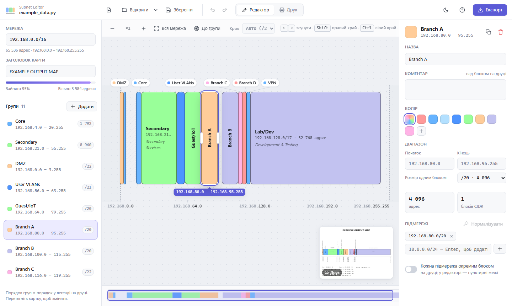
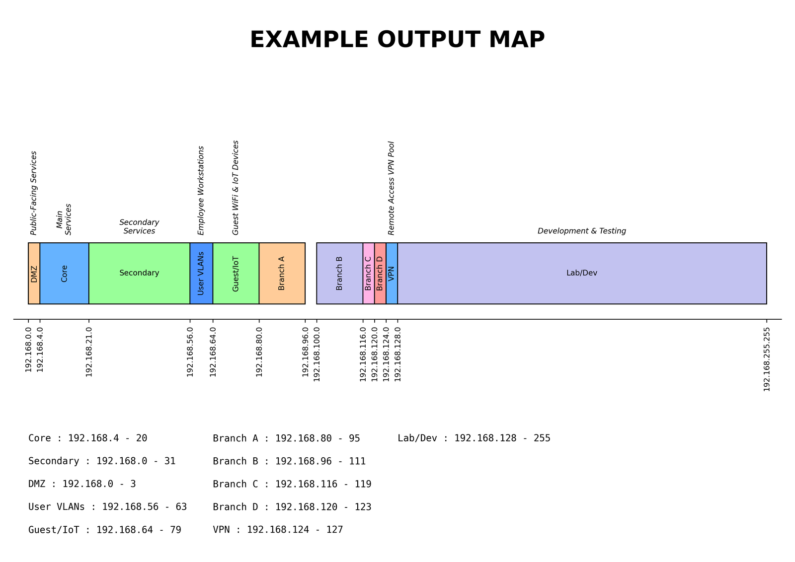

# Візуалізатор підмереж (Subnet Visualizer)

Наочна карта розподілу IP-адрес: мережа показана шкалою, групи підмереж — блоками на ній. Зручно планувати адресацію й класти карту в документацію (PNG, PDF, SVG).



Завантаж `SubnetEditor.exe` з [Releases](https://github.com/kazapanama/network-visualisation/releases/latest) — один файл, Python не потрібен.

## Візуальний редактор (SubnetEditor.exe)

`SubnetEditor.exe` (або `python editor.py`) — редактор карти з інтерфейсом. Мережа показана як шкала, групи — як блоки на ній.

*   **Створити групу:** потягніть мишею по вільному місцю шкали або двічі клікніть по ньому. Кнопка «Додати» ставить групу в перше вільне місце.
*   **Перемістити / змінити розмір:** тягніть блок або ручки на його краях. Межі прилипають до сітки «Крок»; в режимі «Авто» крок дрібнішає, коли наближаєте карту.
*   **Правий клік** — меню дій: на блоці (перейменувати, колір, копіювати, дублювати, розділити в точці кліку, розширити до сусідніх вільних проміжків, видалити), на вільному місці (створити групу тут, заповнити проміжок, вставити скопійовану групу), на картці у списку.
*   **Масштаб:** колесо миші (до курсора), `+`/`−`, `0` — вся мережа, `F` — до вибраної групи. Прокрутка — тягнути шкалу адрес, `Shift`+колесо або мінікарта внизу.
*   **Клавіатура:** `←`/`→` — зсунути групу, `Shift+←/→` — правий край, `Ctrl+←/→` — лівий край, `Delete` — видалити, `Ctrl+D` — дублювати, `Ctrl+C`/`Ctrl+V` — копіювати/вставити групу, `F2` — перейменувати, `Ctrl+Z`/`Ctrl+Y` — скасувати/повторити. `F1` — довідка.
*   **Панель групи:** назва, коментар, колір, точний діапазон (початок/кінець або «розмір одним блоком»), список підмереж (клік по підмережі — редагувати на місці, `↑`/`↓` — сусідній блок того ж розміру), «кожна підмережа окремим блоком» (на друці опис і назва групи показуються один раз, у кожному блоці — його CIDR). Після перетягування список підмереж перераховується в мінімальний набір вирівняних CIDR; кнопка «Нормалізувати» робить це вручну.
*   **Список груп:** порядок = порядок у легенді на друці, змінюється перетягуванням карток.
*   **Попередження:** перекриття груп (червона штриховка), некоректні підмережі (наприклад, пропущена кома між рядками), вихід за межі мережі.
*   **Друк:** вкладка «Друк» і мініатюра в куті показують точний вигляд експорту (той самий рендер, що й `visualizer.py`).
*   **Файли:** відкриття/збереження `.py` (формат, який читає `visualizer.py`) і `.json`; файл `.py` читається лише як дані, код у ньому не виконується. Нещодавні файли — у меню біля «Відкрити», файл можна перетягнути у вікно.
*   **Експорт:** PNG (300 dpi), PDF (A4, векторний), SVG — кольоровий, Ч/Б або обидва.

```bash
python editor.py                # відкриє останній файл
python editor.py data.py        # відкрити конкретний файл
python editor.py data.py --export map.pdf [--bw]   # експорт без вікна
python editor.py --browser      # відкрити в Chrome/Edge замість WebView2
python editor.py --dev          # інтерфейс у звичайному браузері (для розробки)
```

Інтерфейс — HTML/JS у папці `ui/`, показується у вікні через [pywebview](https://pywebview.flowrl.com/) (Microsoft Edge WebView2). Python відповідає за файли, діалоги та рендер для друку.

**Windows 10.** WebView2 є у Windows 11, але на багатьох Windows 10 (особливо без інтернету) його немає. Тоді редактор сам відкривається у вікні Google Chrome або Microsoft Edge в режимі застосунку (без вкладок і адресного рядка) — усе працює так само, діалоги файлів залишаються віндовськими; закриття вікна завершує редактор. Потрібен Chrome/Edge версії 80 або новіший. Якщо немає ні WebView2, ні браузера, редактор покаже повідомлення з посиланням на WebView2 Runtime (для машин без інтернету є «Evergreen Standalone Installer»). Примусово відкрити в браузері: `SubnetEditor.exe --browser`.

### Збірка exe

```bash
pip install -r requirements.txt pyinstaller
build.bat
```

Результат — `dist\SubnetEditor.exe`, один файл, Python для запуску не потрібен. Перший запуск триває кілька секунд (exe розпаковується у тимчасову папку). Помилки, якщо будуть, пишуться в `%APPDATA%\SubnetEditor\editor.log`.

## Командний рядок (visualizer.py)

Те саме зображення без редактора — з файлу даних. Потрібні Python і `matplotlib` (`pip install -r requirements.txt`).

```bash
python visualizer.py                       # бере data.py з поточної папки
python visualizer.py -in example_data.py   # або -in / --input з іншим файлом
```

Результат — `subnet_map.png` (кольорова) і `subnet_map_bw.png` (чорно-біла) у поточній папці:



## Структура файлу даних

Файл даних (Python-скрипт) повинен містити наступні змінні:

*   **`main_subnet`** (str): Головна мережа у форматі CIDR (наприклад, `'192.168.0.0/16'`), яка буде відображена як основна шкала.
*   **`subnet_groups`** (list): Список груп підмереж. Кожна група — це словник з параметрами:
    *   `title` (str): Назва групи (або коментар, якщо `title` відсутній).
    *   `subnets` (list): Список підмереж (строки CIDR або словники з додатковими параметрами).
    *   `comment` (str, опціонально): Додатковий коментар.
    *   `show_full` (bool, опціонально): Чи показувати всі деталі підмереж.
    *   `color` (str, опціонально): Колір групи. Можна вказати назву або hex-код. Доступні назви:
        *   `red` - світло-червоний (#ff9999)
        *   `blue` - синій (#66b3ff)
        *   `light_blue` - світло-синій (#b3e0ff)
        *   `dark_blue` - темно-синій (#4d94ff)
        *   `green` - світло-зелений (#99ff99)
        *   `orange` - світло-оранжевий (#ffcc99)
        *   `purple` - світло-фіолетовий (#c2c2f0)
        *   `pink` - світло-рожевий (#ffb3e6)
*   **`map_title`** (str, опціонально): Заголовок, який буде відображено на діаграмі.

Приклад — файл [`example_data.py`](example_data.py).
